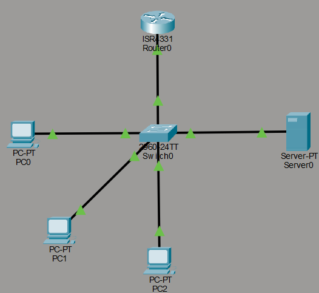

# 🌐 Inter-VLAN Routing Architecture (Router-on-a-Stick)

## 📌 Description
This laboratory demonstrates the design, deployment, and validation of a segmented local network using Cisco Packet Tracer. The architecture implements **Inter-VLAN Routing** via the **Router-on-a-Stick** approach, enabling controlled communication between distinct Virtual Local Area Networks (VLANs) through a single physical 802.1Q trunk link.

---

## 📐 Network Topology & Segmentation Table



### Addressing & VLAN Scheme

| Device | Interface / Subinterface | VLAN | IP Address / Subnet | Role / Gateway |
| :--- | :--- | :--- | :--- | :--- |
| **PC0** | FastEthernet0 | 10 | `192.168.10.10/24` | VLAN 10 Host |
| **PC1** | FastEthernet0 | 20 | `192.168.20.10/24` | VLAN 20 Host |
| **PC2** | FastEthernet0 | 30 | `192.168.30.10/24` | VLAN 30 Host |
| **Router0** | Gig0/0.10 | 10 | `192.168.10.1/24` | Default Gateway VLAN 10 |
| **Router0** | Gig0/0.20 | 20 | `192.168.20.1/24` | Default Gateway VLAN 20 |
| **Router0** | Gig0/0.30 | 30 | `192.168.30.1/24` | Default Gateway VLAN 30 |
| **Router0** | Gig0/0.40 | 40 | `192.168.40.1/24` | Default Gateway VLAN 40 |

---

## 🔧 Implementation Steps

1. **VLAN Creation & Access Port Assignment (Switch0):**
   - Configured VLANs 10, 20, 30, and 40 on Switch0.
   - Assigned `FastEthernet0/1` through `FastEthernet0/3` to their respective VLAN access modes.

2. **Trunk Link Configuration:**
   - Configured `GigabitEthernet0/1` on Switch0 as an 802.1Q trunk link to allow tagged traffic from all configured VLANs.

3. **Subinterface & Encapsulation Setup (Router0):**
   - Created logical subinterfaces on `GigabitEthernet0/0` (`.10`, `.20`, `.30`, `.40`).
   - Configured IEEE 802.1Q encapsulation for each subinterface matching its target VLAN ID and assigned the corresponding IP gateway addresses.

---

## ✅ Validation & Testing

### 1. Trunk Link Status Verification
Verified trunking status on `Switch0` to confirm 802.1Q encapsulation and active state:
```text
Port        Mode         Encapsulation  Status        Native vlan
Gig0/1      on           802.1q         trunking      1
